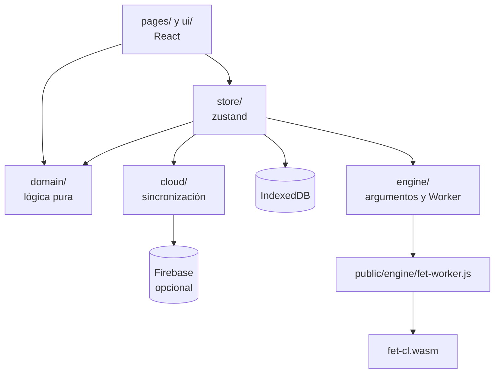
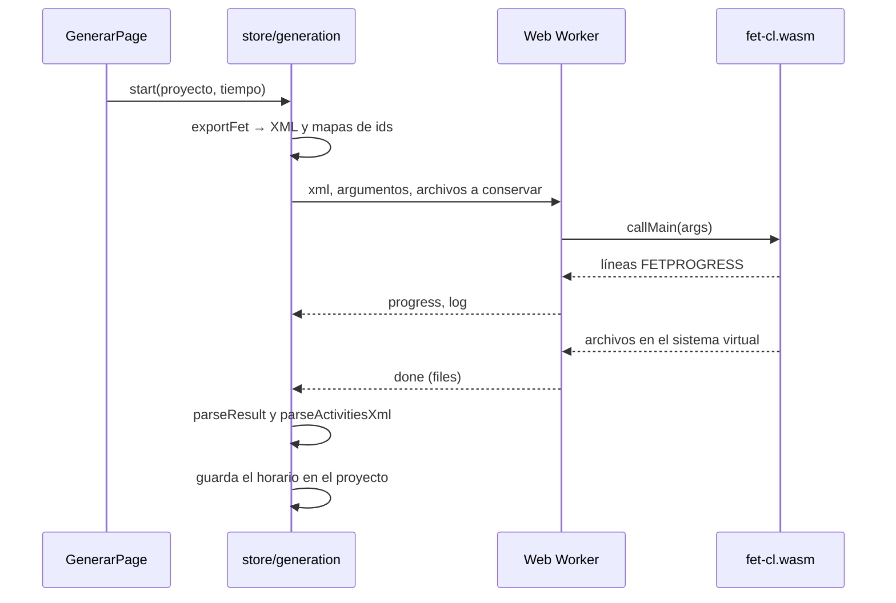

# Arquitectura

Para quien va a modificar el código. El [README](../README.md) cubre la instalación, los comandos y la publicación; este
documento explica cómo funciona por dentro y qué hay que cuidar.

## Principios

- **Sin servidor propio.** El sitio es estático y el cálculo ocurre en el navegador. Sin cuenta, los datos del colegio
  no salen de él y Firebase ni siquiera se carga.
- **Primero lo local.** Con cuenta, la app sigue editando en IndexedDB y la nube se sincroniza en segundo plano.
- **El dominio no conoce la interfaz.** `src/domain/` no importa React y se prueba en Node.
- **El motor es una caja negra.** Se le entrega un `.fet` y se leen sus archivos de salida. Los cambios a FET se limitan
  a la línea de progreso y a ajustes de compilación que no alteran el algoritmo ([detalle](../engine/README.md)).
- **Todo mensaje debe ser accionable y estar en el idioma del colegio**, sin términos de FET.

## Capas

| Carpeta | Responsabilidad |
|---|---|
| [`src/domain/`](../src/domain/) | Modelo, validación, conversión a FET y desde FET, ajuste manual, respaldos |
| [`src/engine/`](../src/engine/) | Argumentos de `fet-cl` y comunicación con el Worker |
| [`src/cloud/`](../src/cloud/) | Motor de sincronización sin dependencias de Firebase, y el adaptador que sí lo usa |
| [`src/store/`](../src/store/) | Proyectos guardados, cuenta, generación en curso, salud del almacenamiento, service worker |
| [`src/pages/`](../src/pages/) | Una pantalla por paso, elegida por el hash de la URL ([`App.tsx`](../src/App.tsx)) |
| [`src/ui/`](../src/ui/) | Componentes compartidos, exportación a Excel, descargas |
| [`public/engine/`](../public/engine/) | Motor compilado, Worker y traducción al español |
| [`engine/`](../engine/) | Parche de FET y script para recompilar |

## Modelo de datos

Definido en [`types.ts`](../src/domain/types.ts). Un `Project` es un horario completo:

| Campo | Contenido |
|---|---|
| `school` | Días, tramos (`clase`, `recreo`, `almuerzo`) y tramos cerrados |
| `courses` | Cursos, con sus `divisions` y los grupos de cada una |
| `subjects`, `rooms` | Asignaturas, cada una con sala especial opcional, y salas |
| `teachers` | Disponibilidad, horas de contrato y máximo de días |
| `assignments` | Carga: curso o grupo × asignatura → profesor y bloques |
| `electives` | Franjas que juntan varios cursos, con sus opciones |
| `rules` | Preferencias globales |
| `locks` | Bloques fijados |
| `timetable` | Último horario generado, o `null` |

### Unidades

[`units.ts`](../src/domain/units.ts) unifica carga y electivos en una sola forma, `Unit`. La exportación, la validación,
las vistas y el ajuste manual trabajan con unidades y no distinguen el origen.

Una franja de electivos se trata como una **división sintética** del curso, con un grupo por opción. Por eso hay dos
variantes de cada función: `effectiveDivisions` y `courseStudentSets` incluyen las franjas, mientras que
`course.divisions` no. Para razonar sobre alumnos, usa siempre las primeras.

`courseStudentSets` devuelve las combinaciones de grupos de un curso, es decir, los distintos horarios que puede tener un
alumno. Su número crece como el producto de los grupos de cada división.

### Claves

| Clave | Formato | Ejemplo |
|---|---|---|
| Tramo | `${día}:${idDelTramo}` | `2:ab12cd34` |
| Unidad de carga | `${idAsignación}` | `9f8e7d6c` |
| Unidad de electivo | `${idFranja}:${idOpción}` | `11aa22bb:33cc44dd` |
| Actividad | `${idUnidad}#${índiceDelBloque}` | `9f8e7d6c#1` |

Los fijados y las ubicaciones se guardan por clave de actividad. Si cambia la lista de bloques de una unidad, las claves
existentes pueden quedar apuntando a un bloque de otra duración o a uno que ya no existe.
[`lockProblems`](../src/domain/manual.ts#L217) detecta los fijados que ya no se pueden respetar.

### Reglas que hay que mantener

- **Toda edición pasa por `update()`** en [`projects.ts`](../src/store/projects.ts): trabaja sobre una copia, ejecuta
  `migrateProject` y guarda.
- **`touch: false`** se usa en lo que no cambia los datos del colegio (fijar, mover, liberar), para no marcar el horario
  como desactualizado.
- **Horario desactualizado** significa `updatedAt > timetable.generatedAt`. `generatedAt` es la hora de *inicio* de la
  generación, para que una edición hecha durante el cálculo lo marque.
- **Al quitar datos, limpia sus fijados.** `migrateProject` limpia referencias en carga y electivos, pero no `locks`:
  cada pantalla lo hace por su cuenta.

## Generación

- **Un Worker por generación.** "Detener" lo termina de inmediato y así se libera la memoria
  ([`runFet.ts`](../src/engine/runFet.ts)).
- **El estado vive fuera de las pantallas** ([`generation.ts`](../src/store/generation.ts)), de modo que el cálculo sigue
  al navegar. Solo hay una generación a la vez.
- **Identidad.** FET usa nombres como identificadores. [`exportFet`](../src/domain/fetExport.ts) genera nombres únicos y
  devuelve los mapas de vuelta (`activityById`, `periodByName`, `roomByName`). Esos mapas solo valen para esa exportación.
- **Semilla.** Es aleatoria en cada generación y no se guarda. Con la misma semilla, el resultado es el mismo.

### Mensajes del Worker

| Dirección | Mensaje | Contenido |
|---|---|---|
| App → Worker | (único) | `xml`, `inputPath`, `outputDir`, `args`, `keep` |
| Worker → App | `started` | `loadMs` |
| Worker → App | `progress` | `placed`, `best`, `total` |
| Worker → App | `log` | `line` |
| Worker → App | `done` | `files`, `lines`, `loadMs`, `genMs` |
| Worker → App | `error` | `message`, `lines` |

### Archivos de salida

Todos son relativos a `/work/out`. "Se conserva" significa que coincide con
[`KEEP_OUTPUT`](../src/engine/args.ts#L42) y vuelve a la app.

| Archivo | Cuándo aparece | ¿Se conserva? | ¿Se usa? |
|---|---|---|---|
| `logs/result.txt` | Siempre | Sí | Sí |
| `logs/errors.txt` | Datos rechazados | Sí | Sí |
| `logs/warnings.txt` | Hay advertencias | Sí | No |
| `logs/difficult_activities.txt` | Se agota el tiempo | Sí | Sí: bloque problemático y cuántos se ubicaron |
| `logs/max_placed_activities.txt` | En todas las ejecuciones medidas | No | No |
| `timetables/horario/horario_activities.xml` | Éxito | Sí | Sí |
| `timetables/horario-highest/horario_activities.xml` | Se agota el tiempo | Sí | Sí: horario parcial, con los bloques sin ubicar sin día ni hora |
| `timetables/horario-current/horario_activities.xml` | Se agota el tiempo | Sí | No |
| `timetables/horario/horario_soft_conflicts.txt` | Con `--writetimetableconflicts=true` | No | Solo en una prueba, para contrastar [`preferences.ts`](../src/domain/preferences.ts) |

### Resultados

[`parseResult`](../src/domain/fetResult.ts#L43) devuelve uno de estos valores:

| `kind` | Significado | Señal |
|---|---|---|
| `ok` | Horario completo | `Generation successful` en `result.txt` |
| `impossible` | FET concluyó que no hay solución | `Impossible` |
| `timeout` | Se acabó el tiempo o se interrumpió | `Time exceeded` o `Generation interrupted` |
| `invalid` | Datos rechazados antes de buscar | Cualquier otro caso; los detalles vienen de `errors.txt` |

Las palabras clave de `result.txt` no se traducen, pero las explicaciones de FET sí. Por eso las expresiones regulares
aceptan inglés y español. El bloque problemático se busca en `result.txt` y en `difficult_activities.txt`, porque al
agotarse el tiempo solo el segundo lo indica.

El horario parcial ([`parsePartial`](../src/domain/fetResult.ts)) y las preferencias no cumplidas
([`unmetPreferences`](../src/domain/preferences.ts)) no cambian el modelo de datos: el primero vive solo en
`store/generation.ts` y las segundas se calculan desde el horario guardado. Se calculan en vez de leer
`horario_soft_conflicts.txt` porque así siguen siendo ciertas tras un ajuste manual, no dependen de un texto traducido e
incluyen lo que la exportación omite (repartir en días cuando dos bloques fijados ya caen el mismo día).

### Pesos en FET

"Obligatoria" se exporta con 100 % y "preferible" con 95 %. No todas las restricciones admiten menos de 100 %: el motor
rechaza las ventanas de profesores, las horas libres de alumnos y el inicio en el primer bloque
([medición](mejoras.md#e7-textos-que-no-coinciden-con-el-comportamiento)). Hoy solo "repartir en días" y "bloques
permitidos" permiten elegir.

## Ajuste manual

[`manual.ts`](../src/domain/manual.ts) responde si un bloque puede ir a un lugar, sin llamar al motor:

| Función | Revisa |
|---|---|
| `slotProblem` | El lugar en sí: recreos, tramos cerrados, fin del día, disponibilidad, consejo, bloques permitidos obligatorios |
| `checkMove` | Choques con otras clases, máximo de días, horas diarias |
| `ruleProblem` | Reglas del día completo: repartir, horas libres, primer bloque, ventanas |
| `checkSwap` | Lo anterior, para dos bloques que se intercambian |
| `checkPlace` | Punto de entrada: intenta mover y, si no se puede, intercambiar |
| `lockProblems` | Fijados que ya no se pueden respetar (lo usa `validate`) |

Tres decisiones de diseño:

- `ruleProblem` compara el horario **antes y después** y solo rechaza lo que el cambio empeora. Un horario que ya
  incumplía algo no impide moverse.
- Las reglas preferibles no se revisan.
- Mover o intercambiar fija el bloque, para que se mantenga al regenerar. `companions` asegura que las clases en
  paralelo se muevan juntas.

## Persistencia

- [`projects.ts`](../src/store/projects.ts) guarda `{ projects, currentId }` como un JSON en IndexedDB, clave
  `horarios-web`, versión 3.
- **Protección de datos:** si la lectura inicial falla, se bloquea la escritura para no sobrescribir lo guardado con un
  estado vacío ([`health.ts`](../src/store/health.ts)).
- **Varias pestañas:** un `BroadcastChannel` avisa de cada guardado, y las demás pestañas recargan los datos conservando
  su horario abierto. Si dos pestañas editan a la vez, gana la última que guarda.
- **Respaldos:** [`backup.ts`](../src/domain/backup.ts) usa un formato propio, versión 2, que no se mueve junto con la
  versión del almacén. Un archivo de una versión más nueva se rechaza. `checkProject` rechaza lo que haría fallar a la
  app y repara lo prescindible, como un horario guardado mal formado. **Al agregar un campo al modelo, agrega también su
  revisión ahí.**
- **Datos dañados:** `App` captura los errores de `validate` y los muestra como un problema por corregir, porque esa
  revisión corre antes de elegir la pantalla y el horario actual queda guardado. "Ir al inicio" de la pantalla de error
  también cierra el horario actual.
- **Cambiar la forma de los datos:** agrega el valor por defecto en `migrateProject`. Si el cambio requiere transformar
  datos, sube `version` en `projects.ts` y, si corresponde, `BACKUP_VERSION`.

## Cuenta y sincronización

Es opcional. Sin las variables `VITE_FIREBASE_*`, `cloudEnabled` es falso y nada de esto aparece. El SDK se carga con un
`import()` solo al iniciar sesión o si hay una sesión guardada.

### Espacios de datos

- Cada cuenta usa su propia clave en IndexedDB, `horarios-web:<uid>`, y sin cuenta se usa `horarios-web`. Así, en un
  computador compartido una cuenta no ve los horarios de otra.
- La clave se decide al cargar [`projects.ts`](../src/store/projects.ts), según `horarios-web-cuenta` en `localStorage`.
  Por eso iniciar y cerrar sesión **recargan la página**, y las demás pestañas también lo hacen con el evento `storage`.
- Cerrar sesión borra la copia local de esa cuenta, y antes avisa si hay cambios sin subir.
- Al entrar, los horarios creados sin cuenta no se mezclan por sí solos: la app ofrece traspasarlos.

### Documentos

`users/{uid}/projects/{projectId}`, con estos campos:

| Campo | Contenido |
|---|---|
| `revision` | Entero que sube de uno en uno |
| `schema` | `BACKUP_VERSION` con que se escribió |
| `data` | El proyecto en JSON, sin `backupAt`, o `null` si se eliminó |
| `updatedAt` | Hora del servidor |

El proyecto se guarda como texto y no como campos de Firestore: siempre se lee y se escribe completo, y así pasa por la
misma validación que un respaldo. Los horarios reales medidos ocupan unos 113 KB, frente al límite de 1 MiB. **No se usa
`.fet`** porque no conserva el horario generado, las horas de contrato ni todas las restricciones.

### Algoritmo

[`SyncEngine`](../src/cloud/engine.ts) no conoce Firebase ni React, y se prueba con una nube en memoria. Compara un hash
del contenido con el último sincronizado en vez de usar `updatedAt`, porque `touch: false` no lo cambia y mover bloques o
generar también debe subirse.

| Situación | Resultado |
|---|---|
| Solo cambió lo local | Se sube cuando el usuario hace una pausa (5 s, máximo 60 s), y también al salir de la pestaña |
| Solo cambió la nube | Reemplaza la copia local, conservando su `backupAt` |
| Cambiaron los dos | La versión local queda como copia nueva "(conflicto fecha)" y el usuario sigue en ella; la de la nube conserva el id |
| Eliminado aquí y editado en otro equipo | Se recupera la versión editada |
| Eliminado en otro equipo y editado aquí | La versión local queda como copia |
| Sin horarios locales al abrir, pero con registro de haberlos tenido | Se vuelven a descargar: nunca se interpreta como eliminarlos |
| Documento dañado o de una versión más nueva | Se avisa, no se aplica y ese horario no se sube |

Reglas que hay que mantener:

- **Nada se sube antes de conocer lo que hay en la nube.** Se espera una respuesta confirmada por el servidor, no por el
  caché de Firestore.
- **No se sincroniza si falló la lectura local** (`readFailed`), porque todo parecería eliminado.
- **Primero se guardan los horarios y luego el registro de lo sincronizado** (`storeFlushed`). En el orden inverso, un
  cierre a medio camino haría que la versión antigua se suba como si fuera un cambio.
- **Los horarios eliminados quedan con `data: null`** para que la eliminación llegue a los demás equipos.
- **Solo una pestaña sincroniza** (`navigator.locks`). Las demás reciben los cambios por el `BroadcastChannel`.
- **La seguridad está en [`firestore.rules`](../firestore.rules).** La configuración web es pública. Las reglas exigen
  correo confirmado y la revisión exactamente siguiente.
- **Al cambiar la forma de los datos,** sube `BACKUP_VERSION`: un equipo con una versión anterior no debe interpretar lo
  que no conoce.

## Service worker

[`sw.js`](../public/sw.js) recibe la versión en la URL de registro y usa un caché por versión.

| Recurso | Estrategia |
|---|---|
| Navegación | Primero la red; sin conexión, la copia guardada |
| Otros archivos | Primero el caché; si falta, la red, y se guarda |
| Instalación | Guarda `./`, lo que enlaza `index.html` y los cuatro archivos del motor |

La nueva versión espera a que el usuario acepte "Actualizar ahora". Los módulos que se cargan bajo demanda no se guardan
al instalar ([E6](mejoras.md#e6-sin-conexión-incompleto)).

## Pruebas

| Dónde | Qué cubre | Cómo correrlo |
|---|---|---|
| [`domain.test.ts`](../src/domain/domain.test.ts) | Jornada, validación, exportación, divisiones, electivos, mensajes de FET y fijados | `npm test` |
| [`backup.test.ts`](../src/domain/backup.test.ts), [`importCarga.test.ts`](../src/domain/importCarga.test.ts), [`fetImport.test.ts`](../src/domain/fetImport.test.ts) | Importaciones y respaldos | `npm test` |
| [`fet.integration.test.ts`](../src/domain/fet.integration.test.ts), [`manual.integration.test.ts`](../src/domain/manual.integration.test.ts) | Generación real con el motor en Node, y sus resultados verificados | `npm test` |
| [`projects.test.ts`](../src/store/projects.test.ts) | Cuándo un horario queda desactualizado al importar, duplicar y editar | `npm test` |
| [`engine.test.ts`](../src/cloud/engine.test.ts), [`account.test.ts`](../src/store/account.test.ts) | Sincronización con una nube en memoria, y espacios de datos por cuenta | `npm test` |
| [`large.test.ts`](../src/domain/large.test.ts) | Tiempos en un colegio sintético | `LARGE=1 npx vitest run src/domain/large.test.ts` |
| [`e2e/app.spec.ts`](../e2e/app.spec.ts) | Flujos en navegadores reales | `npm run build`, luego `npm run e2e` |

Las pruebas de integración se omiten solas si falta el motor. `ui/` y `pages/` no tienen pruebas unitarias. El adaptador
[`firebase.ts`](../src/cloud/firebase.ts) y las reglas no tienen pruebas automáticas, porque requieren los emuladores de
Firebase, que necesitan Java. Se comprobaron una vez contra el proyecto real, con cuentas desechables: **al cambiar las
reglas o el adaptador, repite a mano el flujo con dos navegadores.**

Las pruebas de navegador fijan `Math.random` para que la semilla, y por lo tanto el horario, sea siempre la misma. Sus
pasos deben fallar si no encuentran lo que buscan, no saltarse la comprobación. La grilla interactiva se selecciona con
`.card td.lesson`, porque la página también contiene una copia oculta para imprimir.

## Cómo agregar una regla

1. **[`types.ts`](../src/domain/types.ts):** agrega el campo a `Rules` y su valor por defecto en `migrateProject`.
2. **[`defaults.ts`](../src/domain/defaults.ts):** agrégalo a los proyectos nuevos.
3. **[`ReglasPage.tsx`](../src/pages/ReglasPage.tsx):** agrega el control con una explicación sin términos de FET.
4. **[`fetExport.ts`](../src/domain/fetExport.ts):** escribe la restricción. **Comprueba con el motor qué pesos admite**
   antes de ofrecer "preferible".
5. **[`validate.ts`](../src/domain/validate.ts):** detecta los casos imposibles antes de generar, con un mensaje que
   indique qué corregir.
6. **[`manual.ts`](../src/domain/manual.ts):** si es obligatoria, respétala al mover bloques (`slotProblem` si depende
   solo del lugar, `checkMove` o `ruleProblem` si depende del resto de la semana).
7. **[`fetImport.ts`](../src/domain/fetImport.ts):** traduce la restricción al importar y sácala del informe de lo perdido.
8. **Pruebas:** agrega una generación real en
   [`fet.integration.test.ts`](../src/domain/fet.integration.test.ts) que verifique el resultado, y el caso de movimiento.
9. **[README](../README.md):** agrega la fila a la tabla "Cómo se traduce a FET".

## Limitaciones conocidas

- Una clase tiene un solo profesor, y no hay actividades sin curso.
- Las salas son solo las especiales, una por asignatura y sin disponibilidad propia.
- Las ventanas y las horas diarias son iguales para todos los profesores.
- Sin cuenta, los datos viven en un solo navegador.
- Con cuenta, cada horario pertenece a una sola persona: no se comparte entre usuarios.

El análisis completo y las propuestas están en [mejoras.md](mejoras.md).
